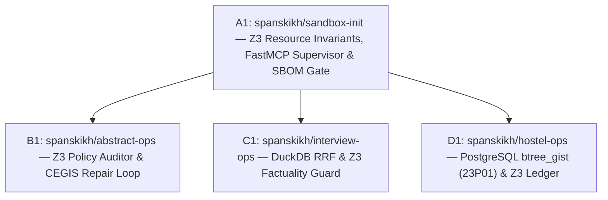

# Sergei Panskikh — Principal SDET, AI QA & Neuro-Symbolic Systems Architect

Deterministic verification harnesses wrapping LLM agents in **formal `Z3` SMT proofs**, **Counterexample-Guided Inductive Synthesis (`CEGIS`)**, **`Pydantic v2` contracts**, **database invariants**, and **offline `FastMCP` `stdio` protocol gates**.

---

## Neuro-Symbolic Verification Cluster (`v0.9.0`)

- **Business Product & Use-Case Guide:** [`docs/PRODUCT_GUIDE.md`](docs/PRODUCT_GUIDE.md) — Practical business workflows, Z3/Pydantic guarantees, prevented operational risks, and single-command `FastMCP` `stdio` Supervisor/Worker orchestration (`CR-024..CR-027`).
- **Governance & Release Traceability:** [`DEVPROCESS.md`](DEVPROCESS.md) · [`RELEASES.md`](RELEASES.md) · [`docs/DEFECTS_AND_CAPA.md`](docs/DEFECTS_AND_CAPA.md) (`CAPA-001..009`) · [`docs/releases/v0.9.0-retrospective.md`](docs/releases/v0.9.0-retrospective.md)

---

## Cluster Portfolio & Engineering Profiles

Each repository ships a standardized 5-section `docs/ENGINEERING_PROFILE.md` covering theoretical foundations, libraries, compute environment, SDLC/QA processes, and benchmark metrics:

- **A1 — [`spanskikh/sandbox-init`](https://github.com/spanskikh/sandbox-init)** ([Architecture](https://github.com/spanskikh/sandbox-init/blob/main/docs/ARCHITECTURE.md) · [Engineering Profile](https://github.com/spanskikh/sandbox-init/blob/main/docs/ENGINEERING_PROFILE.md)) · 
  - `Z3` resource invariants, `FastMCP` `stdio` Supervisor/Worker orchestrator (`CR-025`), topology-aware integration runner (`CR-024`), shared `CycloneDX` PEP 610 SBOM sanitizer (`CR-026`) (`53` fast tests green, `0` `mypy --strict` errors).
- **B1 — [`spanskikh/abstract-ops`](https://github.com/spanskikh/abstract-ops)** ([Architecture](https://github.com/spanskikh/abstract-ops/blob/main/docs/ARCHITECTURE.md) · [Engineering Profile](https://github.com/spanskikh/abstract-ops/blob/main/docs/ENGINEERING_PROFILE.md)) · 
  - `Z3` SMT policy auditor, bounded `CEGIS` rule repair, `Hypothesis` fuzzing (`0` false `SAT` across `180` adversarial specs, `36` fast tests green).
- **C1 — [`spanskikh/interview-ops`](https://github.com/spanskikh/interview-ops)** ([Architecture](https://github.com/spanskikh/interview-ops/blob/main/docs/ARCHITECTURE.md) · [Engineering Profile](https://github.com/spanskikh/interview-ops/blob/main/docs/ENGINEERING_PROFILE.md)) · 
  - Offline hybrid retrieval (`DuckDB` + `RRF`) + `Z3` entity/temporal guard (`Recall@3 = 0.9375`, `MRR = 1.0000`, `p95 = 72.217 ms`, `31` fast tests green).
- **D1 — [`spanskikh/hostel-ops`](https://github.com/spanskikh/hostel-ops)** ([Architecture](https://github.com/spanskikh/hostel-ops/blob/main/docs/ARCHITECTURE.md) · [Engineering Profile](https://github.com/spanskikh/hostel-ops/blob/main/docs/ENGINEERING_PROFILE.md)) · 
  - PostgreSQL `btree_gist` range exclusion (`23P01` under `TOCTOU` races), `Z3` zero-sum triple-entry ledger (`0.0%` double-booking escape, `30` fast tests green).

---

## Core Engineering Pillars

- **Evaluating the Evaluator ("Who Tests the Tests?"):** Every verification oracle (AST/regex doc auditor, `Z3` invariant checker, `Ollama` LLM-as-a-Judge rubric) is verified against seeded defect counterexamples and `Hypothesis` property fuzzing.
- **Zero-Trust LLM Boundaries:** LLMs synthesize candidate structures (`Pydantic v2` JSON schemas), while deterministic symbolic solvers (`Z3`), relational constraints (`PostgreSQL btree_gist`), and `FastMCP` `stdio` contract tests decide acceptance (`SAT`) or rejection (`UNSAT`).
- **Governance & Standards Alignment:** Verification controls mapped to **EU AI Act** robustness requirements, **ISO / IEC 42001**, **ISO/IEC 24029**, **GDPR/BDSG**, and **CycloneDX** SBOM provenance.
