# Business Product & Practical Use-Case Guide (`v0.9.0`)

Practical executive and operator guide explaining what business problems the four products in the `spanskikh` neuro-symbolic cluster (`sandbox-init`, `abstract-ops`, `interview-ops`, `hostel-ops`) and their unified `FastMCP` `stdio` Supervisor/Worker pipeline solve today, the operational risks they prevent, and how engineering managers and operators run them.

---

## 1. Executive Summary: Why Neuro-Symbolic Verification Matters for Business

Enterprises adopting Large Language Models (LLMs) for infrastructure planning, compliance policy drafting, recruiting/RFP synthesis, or transactional front-desk operations face three recurring failure modes:
1. **Unbounded Hallucinations & Policy Drift:** Standard LLMs output plausible text or JSON that silently violates regulatory rules, fabricates candidate skills, or introduces security backdoors.
2. **Financial & Transactional Corruption:** Allowing an LLM agent to trigger database writes directly can double-book inventory under concurrent traffic (`TOCTOU` races) or post unbalanced accounting entries.
3. **Cloud Cost & Data Sovereignty Risks:** Routing sensitive financial rules, candidate CVs, or operational logs to external paid APIs creates GDPR/BDSG exposure and unpredictable token bills.

The `spanskikh` product suite eliminates these failure modes by treating the local LLM (`Ollama: qwen2.5-coder:7b` + `nomic-embed-text`) strictly as an **untrusted candidate synthesizer**. Every proposal is compiled into **`Pydantic v2` structural contracts**, mathematically proven for consistency by the **`Z3` SMT Theorem Prover** (or repaired via **Counterexample-Guided Inductive Synthesis — `CEGIS`**), and enforced by relational storage constraints (`PostgreSQL btree_gist` and `DuckDB` audit logs) across a zero-cloud, two-node Linux cluster (`hippo` 24 GiB RAM + `rhino` 16 GiB RAM).

---

## 2. End-to-End Multi-Agent Value Chain (`v0.9.0`)

```mermaid
flowchart LR
    SUP["FastMCP Supervisor (sandbox-init/orchestrator.py)"]
    P1["1. sandbox-init: Capacity & Supply-Chain Gate"]
    P2["2. abstract-ops: RBAC & Underwriting Policy Auditor"]
    P3["3. interview-ops: Grounded Hybrid RAG & Fact Guard"]
    P4["4. hostel-ops: Triple-Entry Ledger & Booking Engine"]
    SUP -->|check_cluster_plan| P1
    P1 -->|SAT| P2
    P2 -->|audit_policy_ruleset: SAT| P3
    P3 -->|audit_cv_proposal: SAT| P4
    P4 -->|audit_hostel_checkin: SAT| OUT["Verified Multi-Domain Execution + Audit Log"]
```



| Product Repository | Target Business Function | Core Business Problem Solved | Deterministic Guardrails (`Z3` / DB / `Pydantic`) | Measurable Business Outcome (`v0.9.0`) |
| :--- | :--- | :--- | :--- | :--- |
| **A1: `sandbox-init`** | Infrastructure Capacity, Topology & Supply-Chain Governance | Prevents server OOM crashes during local AI inference, host/Docker config drift (`CR-024`), and local path leaks in software bills of materials (`CR-026`). | Z3 linear/implication RAM solver (`24 GiB` / `16 GiB`), `/proc/meminfo` headroom gate, and `CycloneDX` PEP 610 `file://` SBOM sanitizer. | `0` OOM allocation escapes; `4/4` repos produce deterministic, path-clean `CycloneDX` SBOMs (`53` offline + `3` live tests green). |
| **B1: `abstract-ops`** | Cybersecurity RBAC & Financial Underwriting Compliance | Prevents unauthorized external access without MFA, contradictory underwriting rules, dead policy logic, and shadowed rules (`CR-002`). | Z3 SMT reachability, pairwise `ALLOW`/`DENY` disjointness, MFA invariant proof, subsumption checker, and bounded CEGIS repair. | `0` false `SAT` across `180` adversarial/fuzz specs; automatic policy repair converges in `<= 2` iterations (`36` offline tests green). |
| **C1: `interview-ops`** | Executive Recruiting, HR Tailoring & RFP Proposal Grounding | Eliminates fabricated candidate skills, inflated tenure dates, and unverified resume/RFP claims while transparently reporting skill gaps. | Hybrid `pgvector` + `tsvector` `RRF` retrieval coupled with Z3 referential, chronological, skill-subset, and free-text lexical guards (`CR-003`). | `Recall@3 = 0.9375`, `MRR = 1.0000`, `p95 = 72.22 ms`; `100%` of fabricated skills/years blocked (`31` offline tests green). |
| **D1: `hostel-ops`** | Hospitality Check-In Operations, Housekeeping & Accounting | Prevents double-booked beds under concurrent check-ins, check-ins into uncleaned rooms, and unbalanced financial ledger postings. | Z3 zero-sum triple-entry conservation (`sum == 0`), disjoint stay intervals, `CLEAN -> DIRTY` state machine, and PostgreSQL `btree_gist` (`23P01`). | `0.0%` double-booking escape under concurrent race tests; `100%` balanced ledger transactions (`30` offline tests green). |

---

## 3. Product Deep-Dives & Practical Workflows

### 3.1 `sandbox-init` — Infrastructure Capacity Planner, Topology Runner & SBOM Sanitizer

- **Who Uses It:** Platform Engineers, DevOps/SRE Teams, and CISO Supply-Chain Auditors.
- **Business Problem:** Running local AI models alongside relational databases on fixed on-premise hardware frequently causes Out-Of-Memory (OOM) outages or build starvation. Additionally, running live integration suites across host workstations and Docker containers normally requires fragile manual `.env` edits, while Python editable installs (`PEP 610`) leak developer workstation paths (`file:///...`) into compliance SBOM artifacts.
- **Practical Workflow:**
  1. **Input:** Operator requests a single-node or two-node (`hippo` + `rhino`) memory allocation plan for LLM inference (`h_llm`, `r_llm`), database engines (`h_db`, `r_db`), and OS/build reserve (`h_res`, `r_res`), or invokes the CEGIS synthesizer.
  2. **Deterministic Verification (`Z3` + Telemetry):**
     - Verifies total node caps (`h_llm + h_db + h_res <= 24 GiB` with `h_res >= 4 GiB`; `r_llm + r_db + r_res <= 16 GiB` with `r_res >= 3 GiB`).
     - Enforces workload anti-affinity on `rhino` (`Implies(r_llm > 6, r_db <= 4)`) and cluster-wide build headroom (`>= 4 GiB` free on at least one node).
     - Samples live `/proc/meminfo` via `record_node_memory_telemetry` and persists audit verdicts to `DuckDB`.
  3. **Topology & Supply-Chain Automation (`CR-024` & `CR-026`):**
     - `sandbox_init.topology` (`./scripts/run_integration.sh`) automatically detects host vs. container runtime and maps container hostnames (`ollama`, `host.docker.internal`, `/app/data/*`) to `127.0.0.1` and local repository data directories.
     - `sandbox_init.sbom` (`./scripts/sanitize_sbom.sh --all-repos`) strips PEP 610 local `file://` references from `CycloneDX` BOMs across all 4 repositories and verifies zero host-path leakage (`CAPA-007`).
- **Exposed `FastMCP` `stdio` Tools:** `check_cluster_allocation`, `check_cluster_plan`, `synthesize_valid_allocation`, `record_node_memory_telemetry`.

---

### 3.2 `abstract-ops` — Formal RBAC & Financial Underwriting Policy Auditor

- **Who Uses It:** Compliance Officers, Security Architects, and FinTech Underwriting Managers.
- **Business Problem:** When compliance rules or access policies are drafted or updated (by humans or LLMs), subtle logical overlaps allow an external contractor without Multi-Factor Authentication (MFA) to trigger an `ALLOW` rule, or introduce dead/shadowed rules that never fire in production.
- **Practical Workflow:**
  1. **Input:** A natural-language policy specification (via `synthesize_verified_policy`) or a structured JSON `RuleSetProposal` containing prioritized `ALLOW`/`DENY` rules over role, transaction amount, external status, and MFA state (via `audit_policy_ruleset`).
  2. **Deterministic Verification (`Z3` + `CEGIS`):**
     - **Dead-Rule Detection:** Proves every rule has a non-empty activation region (`SAT`).
     - **Ambiguity / Collision Detection:** Proves no input vector simultaneously satisfies an `ALLOW` and a `DENY` rule at the same priority level.
     - **Mandatory MFA Security Guardrail:** Mathematically proves `UNSAT` for any state where `is_external == True`, `mfa_verified == False`, and verdict is `ALLOW`.
     - **Subsumption & Shadowing Detector (`CR-002`):** Proves (`UNSAT(e2 and not e1)`) whether a narrower rule is completely masked by a broader rule.
     - If any check fails, Z3 extracts an exact counterexample vector and feeds it back to the local LLM (`CEGIS`), converging on a mathematically verified policy in `<= 2` iterations.
  3. **Business Outcome:** Auditable, conflict-free policy JSON persisted to `DuckDB` before deployment to production policy engines.
- **Exposed `FastMCP` `stdio` Tools:** `audit_policy_ruleset`, `synthesize_verified_policy`.

---

### 3.3 `interview-ops` — Grounded Hybrid RAG & Fact-Checked Proposal Engine

- **Who Uses It:** Technical Recruiters, Consulting Proposal Teams, and HR Operations Managers.
- **Business Problem:** Generative AI tools routinely embellish candidate resumes or consulting proposals by sneaking in unverified keywords from a job description (e.g., adding `"Kubernetes"` or extending employment dates) to match a prompt—exposing firms to background-check failures and contractual misrepresentation.
- **Practical Workflow:**
  1. **Input:** A target job description or RFP requirement query submitted to `hybrid_search_ssot`, `generate_verified_cv_claims`, or `audit_cv_proposal`.
  2. **Hybrid Retrieval (`rhino` PostgreSQL `pgvector` + `tsvector`):**
     - Computes 768-dimensional embeddings (`nomic-embed-text` on `hippo`) and executes Reciprocal Rank Fusion (`RRF`, `k=60`) combining semantic vector similarity with exact lexical full-text ranking over Single Source of Truth (SSOT) experience records (`Recall@3 = 0.9375`, `MRR = 1.0000`, `p95 = 72.22 ms`).
  3. **Deterministic Verification (`Z3` + Lexical Entity/Year Guard `CR-003`):**
     - **Referential Grounding:** Every synthesized claim must reference an authentic `source_record_id` from the retrieved SSOT.
     - **Temporal & Entity Lock:** Company name, `start_year`, and `end_year` must match the SSOT record exactly.
     - **Structured & Free-Text Skill Subset Guard:** Both structured `claimed_skills` and any technology tokens or years scanned inside free-text `bullet_text` (`CR-003`) must belong to that role's verified SSOT record. Unverified job requirements are quarantined into `missing_required_skills`.
  4. **Business Outcome:** A fact-checked proposal or CV tailored to the client's requirements paired with an explicit, honest skill-gap disclosure.
- **Exposed `FastMCP` `stdio` Tools:** `hybrid_search_ssot`, `generate_verified_cv_claims`, `audit_cv_proposal`.

---

### 3.4 `hostel-ops` — Triple-Entry Financial Ledger & Anti-Overbooking Engine

- **Who Uses It:** Hospitality Operations Managers, Property Management System (PMS) Integrators, and Financial Controllers.
- **Business Problem:** Front-desk staff often record check-ins, room assignments, and split payments as unstructured notes. Automating these notes with an unguarded LLM risks checking a guest into a dirty bed, double-booking a bed during simultaneous check-in requests, or committing out-of-balance accounting entries.
- **Practical Workflow:**
  1. **Input:** An unstructured operator check-in note (via `ingest_operator_checkin_note`) or a structured `CheckInEventProposal` (via `audit_hostel_checkin`), plus housekeeping completion events (`mark_bed_cleaned`).
  2. **Deterministic Verification (`Z3` + PostgreSQL `btree_gist`):**
     - **Triple-Entry Conservation Law:** Z3 proves that the sum of all debit/credit ledger legs equals zero (`sum(amount_cents) == 0`) with strictly positive transaction volume.
     - **Disjoint Stay Intervals:** Z3 verifies that the proposed half-open stay interval `[check_in_day, check_out_day)` does not overlap any existing booking for `bed_id`.
     - **Housekeeping State Guard:** Z3 requires current bed state to be `CLEAN` before allowing check-in.
     - **Database Storage-Engine Backstop (`CAPA-001`):** Upon `SAT`, the transaction commits atomically on `rhino` PostgreSQL where an idempotent `EXCLUDE USING gist (bed_id WITH =, int4range(check_in_day, check_out_day, '[)') WITH &&)` constraint rejects concurrent `TOCTOU` race collisions with `SQLSTATE 23P01` (`ExclusionViolation`), while transitioning the bed `CLEAN -> DIRTY`.
  3. **Business Outcome:** Zero overbookings, enforced housekeeping turnaround before occupancy, and a mathematically balanced ledger trail.
- **Exposed `FastMCP` `stdio` Tools:** `audit_hostel_checkin`, `ingest_operator_checkin_note`, `mark_bed_cleaned`.

---

## 4. Unified Multi-Agent Supervisor Workflow (`CR-025`)

In `v0.9.0`, `sandbox-init` introduces a single-command **`FastMCP` `stdio` Supervisor/Worker Orchestrator** (`src/sandbox_init/orchestrator.py` and `./scripts/run_supervisor_chain.sh`) that chains all four domain products over standard Model Context Protocol (`stdio`) sessions while verifying 12-tool namespace disjointness:

1. **Hop 1 (`sandbox-init` -> `check_cluster_plan`):** Confirms cluster RAM capacity and anti-affinity invariants are `SAT` before launching domain workloads.
2. **Hop 2 (`abstract-ops` -> `audit_policy_ruleset`):** Verifies the active access-control and underwriting rule-set is conflict-free and enforces MFA (`SAT`).
3. **Hop 3 (`interview-ops` -> `audit_cv_proposal`):** Verifies candidate/proposal claims against SSOT records with zero hallucinated skills or dates (`SAT`).
4. **Hop 4 (`hostel-ops` -> `audit_hostel_checkin`):** Verifies bed availability, `CLEAN` housekeeping status, and zero-sum triple-entry ledger balance (`SAT`).

If any hop encounters an invariant violation (`unsat-sandbox`, `unsat-abstract`, `unsat-interview`, or `unsat-hostel`), the Supervisor deterministically short-circuits downstream hops and returns a structured `OrchestrationReport` (`Pydantic v2`) pinpointing the exact failing hop, tool name, and Z3 counterexample violations.

---

## 5. Operator Quickstart Commands (`v0.9.0`)

Run all operational workflows from `~/projects/sandbox-init` using the local `.venv/bin/` toolchain and logged execution wrappers (`PAGER=cat`):

```bash
# 1. Execute the full 4-repo FastMCP stdio Supervisor/Worker chain (1 SAT + 4 UNSAT proofs)
cd ~/projects/sandbox-init
./scripts/run_supervisor_chain.sh --dry-run
./scripts/run_supervisor_chain.sh --scenario all --format summary

# 2. Run topology-aware live hippo <-> rhino cluster integration tests (CR-024)
./scripts/run_integration.sh --dry-run
./scripts/run_integration.sh

# 3. Generate and verify sanitized CycloneDX SBOMs across all 4 product repos (CR-026)
./scripts/sanitize_sbom.sh --dry-run
./scripts/sanitize_sbom.sh --all-repos

# 4. Inspect registered FastMCP stdio servers via Antigravity CLI (agy v1.5.13)
agy mcp list
```
